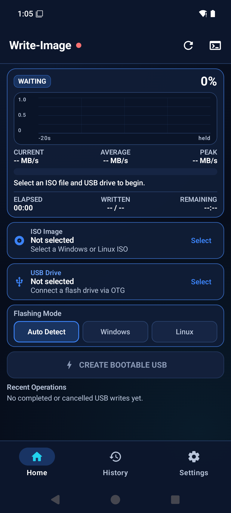
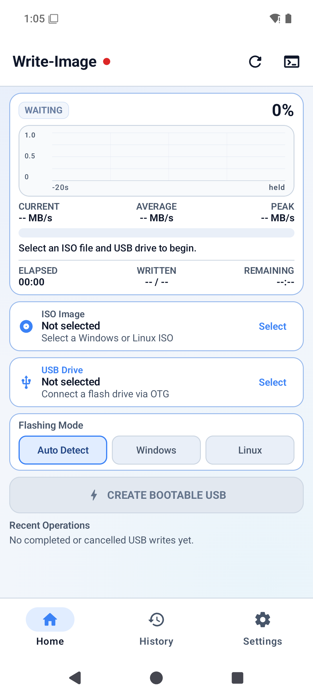
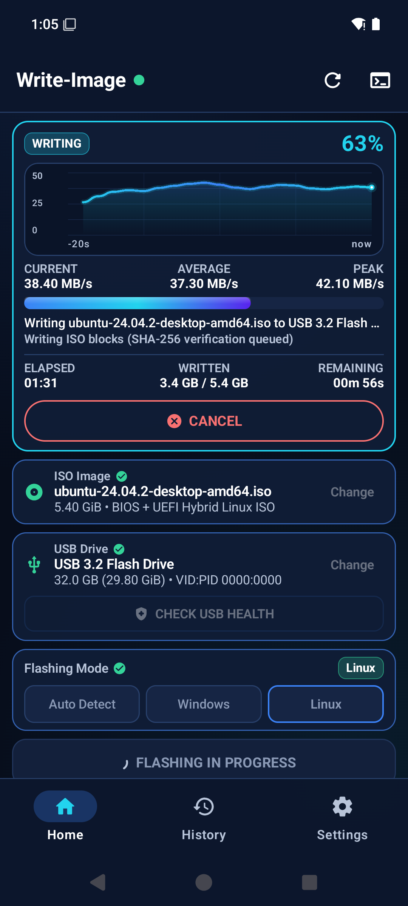
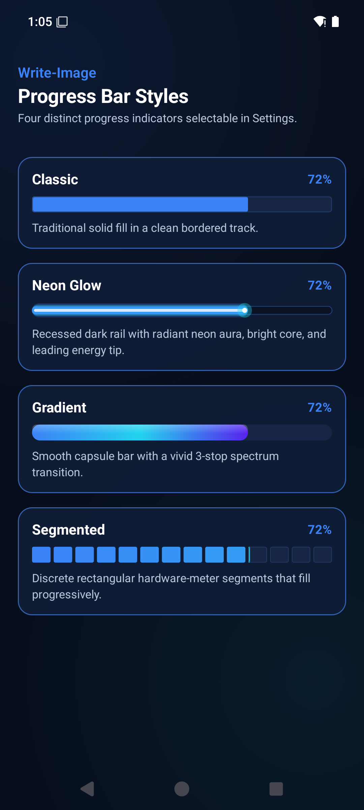
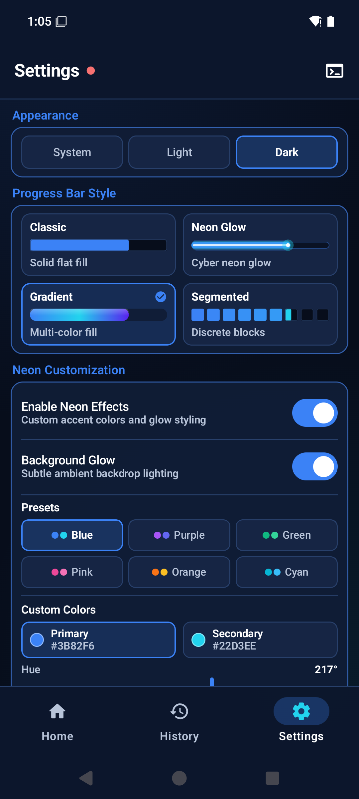

<div align="center">
  

  <h1>Write-Image</h1>

  <p>
    <strong>Create real, verified bootable USB drives from Windows and Linux ISO images directly on Android — no root required.</strong>
  </p>

  <p>
    <a href="https://github.com/ong-ki/Write-Image/releases/latest">
      
    </a>
    
    
    
    <a href="LICENSE">
      
    </a>
  </p>

  <p>
    <a href="https://github.com/ong-ki/Write-Image/releases/latest"><strong>⬇ Download Latest APK</strong></a>
    &nbsp;•&nbsp;
    <a href="#screenshots">Screenshots</a>
    &nbsp;•&nbsp;
    <a href="#features">Features</a>
    &nbsp;•&nbsp;
    <a href="#installation">Installation</a>
    &nbsp;•&nbsp;
    <a href="#usb-flashing-guide">Flashing Guide</a>
    &nbsp;•&nbsp;
    <a href="https://github.com/ong-ki/Write-Image/issues">Report a Bug</a>
  </p>
</div>

---

## Download

Get the latest ready-to-install Android APK directly from GitHub Releases:

👉 **[Download Latest APK (GitHub Releases)](https://github.com/ong-ki/Write-Image/releases/latest)**

> **Compatibility:** Requires Android 8.0 (API 26) or newer and a device with USB OTG (USB Host) hardware support.

---

## Screenshots

<div align="center">
  <table>
    <tr>
      <td align="center" width="33%">
        <br />
        <strong>Home Screen (Dark)</strong><br />
        <sub>ISO &amp; USB selection, Flashing Mode, and guided workflow</sub>
      </td>
      <td align="center" width="33%">
        <br />
        <strong>Home Screen (Light)</strong><br />
        <sub>Adaptive Light Theme with full surface &amp; contrast support</sub>
      </td>
      <td align="center" width="33%">
        <br />
        <strong>Flashing Interface*</strong><br />
        <sub>Live progress bar, transfer speed graph, written/total bytes &amp; ETA</sub>
      </td>
    </tr>
  </table>
  <table>
    <tr>
      <td align="center" width="50%">
        <br />
        <strong>Four Progress Bar Styles</strong><br />
        <sub>Classic, Neon Glow, Gradient, and Segmented</sub>
      </td>
      <td align="center" width="50%">
        <br />
        <strong>Compact Settings &amp; Theme Customization</strong><br />
        <sub>Theme mode, progress styles, neon presets, HSV picker &amp; USB options</sub>
      </td>
    </tr>
  </table>
</div>

<sub>*The Flashing Interface screenshot was captured on an Android 15 emulator using a safe demonstration state because no physical USB flash drive is attached inside the emulator.</sub>

---

## About Write-Image

**Write-Image** is a native Android utility for creating bootable USB flash drives directly from `.iso` and `.img` files stored on your phone or SD card.

Instead of requiring root privileges or shell access to `/dev/block/*`, Write-Image uses Android's official **USB Host API** (`UsbManager` + `UsbDeviceConnection`) to communicate directly with standard USB Mass Storage devices over **Bulk-Only Transport (BOT 1.0)** and **SCSI block commands**, while reading multi-gigabyte images via Android's **Storage Access Framework (SAF)**.

Because Android's `UsbManager` only enumerates external USB OTG peripherals, internal phone storage is never exposed or writable.

---

## Features

- **ISO & Disk Image Analysis** — Opens `.iso` and `.img` files via Android's Storage Access Framework (SAF) and inspects MBR, GPT, ISO-9660/Joliet, El Torito, and ECMA-167 UDF 1.02–2.01 headers to determine bootability and the required write strategy.
- **USB OTG Drive Detection & Probing** — Automatically detects external USB Mass Storage drives (Bulk-Only Transport `0x08/0x06/0x50`), probes SCSI geometry, capacity, block size, and write-protect status, and immediately resets UI state when a drive is unplugged.
- **Three Flashing Modes**
  - **Automatic ISO Detection** — Selects the appropriate strategy from the inspected image headers.
  - **Windows Bootable USB** — Parses Windows UDF/ISO-9660 images and writes either an MBR + FAT32 layout (when all files are <= 4 GiB) or a GPT dual-partition layout (FAT32 EFI System Partition + NTFS/exFAT data partition when `sources/install.wim` exceeds 4 GiB), with optional Windows 11 hardware-check bypass helpers (`TPM`, `Secure Boot`, `RAM`, `CPU`).
  - **Linux Bootable USB** — Performs direct sector-by-sector raw writes (`LBA 0..N`) for isohybrid Linux ISOs (Ubuntu, Fedora, Debian, Arch, Mint, Kali, etc.) and raw disk images.
- **Post-Write Verification & Safety Checks** — Runs pre-flight checks (capacity, write-protection, protocol compatibility, flashing-mode compatibility), explicit destructive-erase confirmation, `SYNCHRONIZE CACHE`, and optional post-write SHA-256 read-back verification.
- **Real-Time Progress & Transfer Speed Graph** — Displays overall percentage, confirmed written/total bytes, elapsed clock, remaining ETA, live 20-second throughput chart, and Current / Average / Peak MB/s metrics derived strictly from confirmed written bytes.
- **Foreground Service & Instant Cancellation** — Runs flashing inside a `dataSync` Foreground Service with a partial `WakeLock`, live notification progress, screen-awake handling while active, and cooperative cancellation + clean resource teardown.
- **Non-Destructive USB Health Check** — Runs a quick capacity, sequential read/write speed, SHA-256 sample verification, and connection-stability diagnostic without wiping existing files on a formatted drive.
- **Guided Flashing Workflow** — Highlights the active setup step label (`USB Drive` -> `ISO Image` -> `Flashing Mode` -> `CREATE BOOTABLE USB`) with subtle text-only pulsing cues.
- **Appearance & Customization**
  - **System Default, Light Theme, and Dark Theme** with immediate switching.
  - **Four distinct Progress Bar Styles**: `Classic`, `Neon Glow`, `Gradient`, and `Segmented`.
  - **Neon Customization**: 6 color presets, custom primary/secondary HSV color picker, glow intensity and radius sliders, ambient background glow toggle, and one-tap **Restore Defaults** (preserving history and selected files).
- **Operation History & Diagnostic Log** — Persists recent flashing operations (status, size, duration, average speed, verification summary) and provides a live USB/SCSI diagnostic log sheet.

---

## Installation

1. Open the **[Releases page](https://github.com/ong-ki/Write-Image/releases/latest)**.
2. Download the latest APK (`Write-Image-v1.0.0.apk`).
3. Open the downloaded `.apk` file on your Android device.
4. If Android prompts you, allow **Install unknown apps** for your browser or file manager.
5. Tap **Install** and launch **Write-Image**.

**System Requirements**
- **Minimum Android Version:** Android 8.0 Oreo (API 26)
- **Target Android Version:** Android 16 (API 36)
- **Hardware:** Android device supporting USB Host (OTG) + compatible USB OTG adapter/cable + USB Mass Storage flash drive

---

## USB Flashing Guide

> **⚠️ Warning — Data Loss:** Creating a bootable USB drive **completely erases all existing partitions and data** on the selected USB flash drive. Back up any important files on the USB drive before starting.

1. **Connect a USB Drive** — Plug a standard USB flash drive into your phone using a USB OTG adapter (enable *OTG Connection* in Android Settings if required by your device manufacturer).
2. **Select the USB Drive** — Tap **USB Drive → Select**, choose your external drive, and grant Android USB Host permission when prompted.
3. **Select an ISO Image** — Tap **ISO Image → Select** and pick a Windows or Linux `.iso` / `.img` file.
4. **Choose a Flashing Mode** — Confirm **Auto Detect**, **Windows**, or **Linux** (for Windows ISOs, you can also configure optional Windows 11 bypass flags if needed).
5. **Start Flashing** — Tap **CREATE BOOTABLE USB**, review the target drive and erase warning, and confirm.
6. **Wait for Completion** — Keep the USB drive firmly connected until writing, cache flush, and SHA-256 verification finish.

---

## Compatibility Matrix

| Image Type | Detection | Write Strategy | Boot Target |
| :--- | :--- | :--- | :--- |
| **Linux Hybrid ISO** (Ubuntu, Fedora, Debian, Arch, Mint, Kali) | ISO-9660 + MBR and/or GPT (`isohybrid`) | Direct raw sector write (`LBA 0..N`) + SHA-256 read-back | BIOS and/or UEFI (matches source ISO) |
| **Raw Disk Image** (`.img`, Raspberry Pi OS, OpenWrt, FreeBSD) | Valid MBR and/or GPT partition table | Direct raw sector write (`LBA 0..N`) + SHA-256 read-back | Matches source disk image |
| **Windows ISO (all files <= 4 GiB)** | UDF / ISO-9660 with `/efi/boot/boot*.efi` + `sources/boot.wim` | MBR + FAT32 partition + UDF extraction + per-file SHA-256 | **UEFI** (Secure Boot compatible) |
| **Windows 10/11 ISO (`install.wim` > 4 GiB)** | UDF / ISO-9660 with file > 4 GiB | GPT dual-partition (FAT32 ESP + NTFS/exFAT data) + per-file SHA-256 | **UEFI** (Secure Boot compatible) |
| **Non-Hybrid Optical ISO** | ISO-9660/UDF without MBR/GPT or `/efi/boot/` | Raw write only with explicit non-bootable acknowledgment | Not guaranteed bootable (explicitly warned) |

---

## Technical Information

| Component | Implementation |
| :--- | :--- |
| **Language** | Kotlin (JVM 17) |
| **UI Framework** | Jetpack Compose + Material 3 (`androidx.compose.material3`) |
| **Architecture** | Single-activity Compose UI + `AndroidViewModel` + `StateFlow` + `UsbWriteService` Foreground Service + layered `core/` packages (`usb`, `image`, `filesystem`, `safety`, `writer`, `storage`, `util`) |
| **Preferences & Persistence** | Jetpack DataStore Preferences (`CustomizationDataStore`) + `SharedPreferences` (`AppPreferencesStore`) |
| **USB Access** | Android USB Host API (`UsbManager` / `UsbDeviceConnection`) → USB Mass Storage Bulk-Only Transport (BOT 1.0) → SCSI Block Device (`INQUIRY`, `TEST UNIT READY`, `REQUEST SENSE`, `MODE SENSE`, `READ CAPACITY 10/16`, `READ/WRITE 10/16`, `SYNCHRONIZE CACHE`) |
| **Image & Filesystem Engines** | 64-bit SAF `ImageSource`, ECMA-167 UDF 1.02–2.01 & ISO-9660/Joliet readers, MBR & GPT partitioners, FAT32 (VFAT LFN), exFAT, and NTFS writers |
| **Splash Screen** | AndroidX `core-splashscreen` + seamless Compose handoff |
| **Application ID** | `com.usbbootable.creator` |
| **Min / Target / Compile SDK** | API 26 (Android 8.0) / API 36 (Android 16) / API 36 |

---

## Build from Source

### Prerequisites
- **JDK 17**
- **Android SDK** with Platform 36 and Build-Tools 36 (or Android Studio Meerkat / Narwhal+)

### Commands

```bash
# Clone the repository
git clone https://github.com/ong-ki/Write-Image.git
cd Write-Image

# Run JVM unit tests (99 tests covering USB/BOT/SCSI, UDF/ISO, FAT32/exFAT/NTFS, GPT/MBR, safety, state & theme)
./gradlew testDebugUnitTest

# Run Android Lint
./gradlew lintDebug

# Build Debug APK -> app/build/outputs/apk/debug/app-debug.apk
./gradlew assembleDebug

# Build Release APK (R8 minified & resource-shrunk) -> app/build/outputs/apk/release/app-release.apk
./gradlew assembleRelease
```

---

## Known Limitations

- **USB OTG & BOT Protocol Required:** The Android device must support USB Host mode (`FEATURE_USB_HOST`). UASP-only USB SSD enclosures (`protocol 0x62` without a Bulk-Only Transport `0x50` fallback) cannot be accessed from user-space BOT without kernel/root support and are detected and reported.
- **OEM Auto-Mount (`vold`) Contention:** On some OEM Android builds, Android's storage daemon may hold an exclusive lock on a newly plugged drive. Unmounting/ejecting the drive in **Android Settings → Storage** (while keeping it physically connected) and tapping **Retry SCSI Probe** typically resolves interface claim failures.
- **OEM OTG Toggle:** Some devices (e.g., Oppo, Realme, OnePlus, Vivo) disable USB OTG power until **OTG Connection** is enabled in Android system settings.
- **Windows Extraction Boot Target:** Extracted Windows 10/11 USB drives target **UEFI** systems (Legacy BIOS / CSM boot is not supported for extracted Windows media).
- **Hardware Coverage:** Real-world USB flash drive behavior varies by controller firmware, OTG cable power delivery, and Android OEM kernel USB stacks; physical end-to-end flashing should always be verified on target hardware before relying on a newly created bootable drive.

---

## License

This project is licensed under the **MIT License** — see the [LICENSE](LICENSE) file for details.

Contributions, bug reports, and pull requests are welcome. Please run `./gradlew testDebugUnitTest lintDebug` before submitting changes.

---

## Support & Bug Reports

Found a bug, USB compatibility issue, or crash? Open an issue on GitHub:

🐛 **[https://github.com/ong-ki/Write-Image/issues](https://github.com/ong-ki/Write-Image/issues)**

When reporting an issue, please include:
- Android device model and Android OS version
- USB flash drive model / capacity (and OTG adapter type)
- ISO filename / OS distribution (and flashing mode selected)
- Relevant entries from the in-app **Diagnostic Log** (top-right terminal icon)
